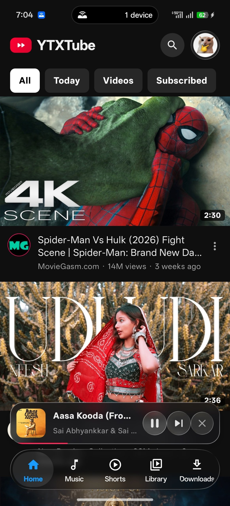
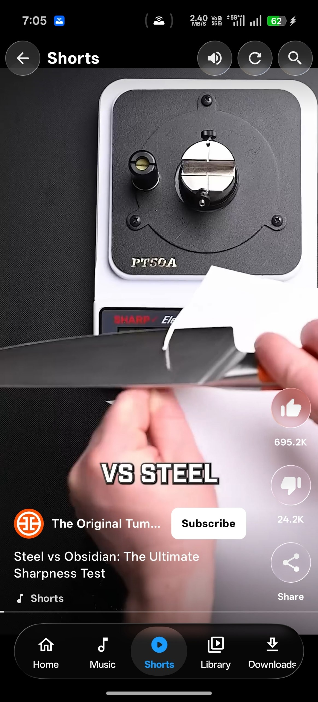
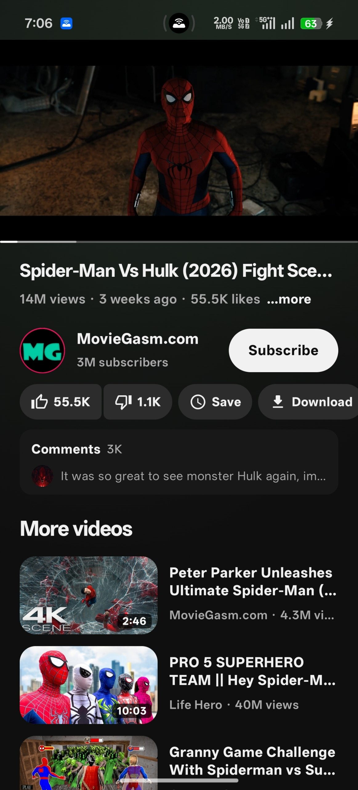
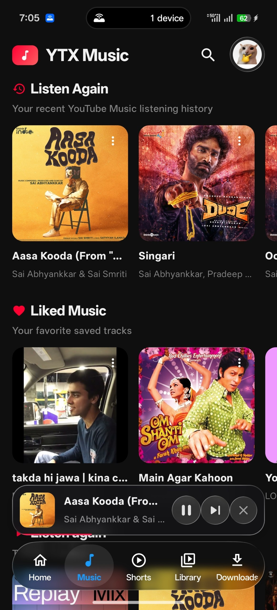
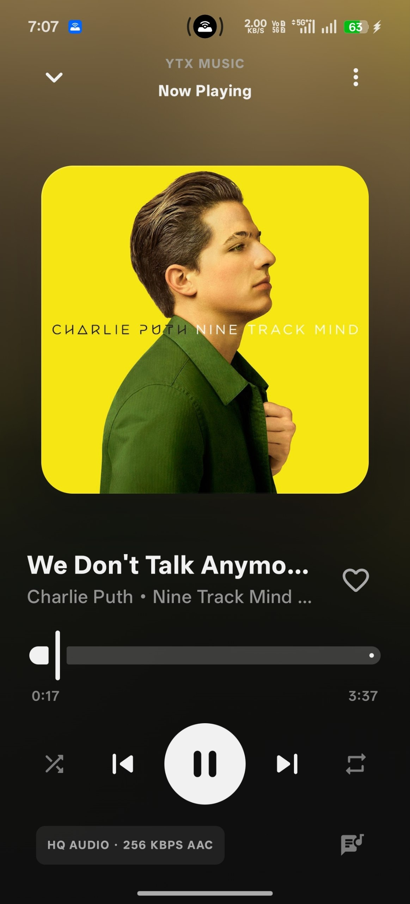
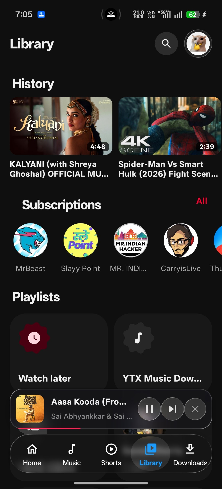
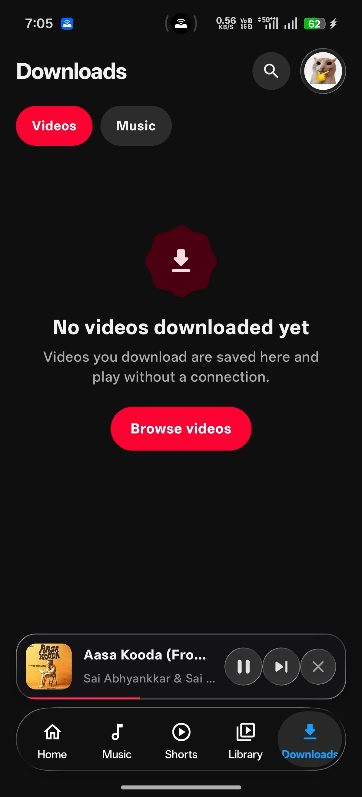
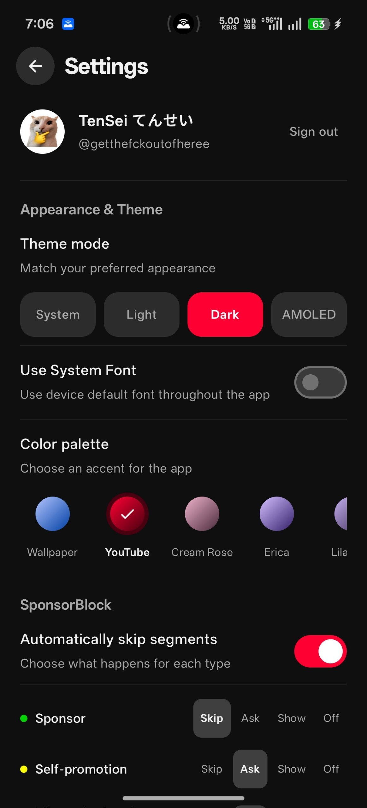

# YT

A lightweight YouTube and YouTube Music client with a modern Liquid Glass UI, ad-free playback, endless personalised Shorts, synced Apple Music-style lyrics, and high-quality downloads.

## Features

- Liquid Glass interface across the player, Shorts, fullscreen controls, settings and music mini player
- Ad-free YouTube and YouTube Music playback
- Personalised Shorts feed with a one-tap fresh batch and loading animation
- Synced lyrics with an Apple Music-style animated lyric view
- High-quality video and audio downloads up to 4K / HDR
- 4K HDR playback and customizable fixed resolution quality lock
- Search, channels, playlists and community posts
- Background playback and picture-in-picture
- Android TV support too: the same APK runs on TV with full D-pad navigation

## Build & release (GitHub Actions)

1. Push this project to your GitHub repo.
2. Go to **Actions → Build & Release → Run workflow**, type a version (e.g. `2.3.0`) and what's new, and run it.
3. The APK (`YT.apk`) appears under **Releases**. Installed apps check your repo's latest release and offer the update inside the app.

Developer: [@alive_harsh_](https://www.instagram.com/alive_harsh_) · Based on the open-source YTXTube project (GPL-3.0).

## Screenshots

<table>
  <tr>
    <td align="center"><br><sub>Home</sub></td>
    <td align="center"><br><sub>Shorts</sub></td>
    <td align="center"><br><sub>Video player</sub></td>
    <td align="center"><br><sub>Music</sub></td>
  </tr>
  <tr>
    <td align="center"><br><sub>Music player</sub></td>
    <td align="center"><br><sub>Library</sub></td>
    <td align="center"><br><sub>Downloads</sub></td>
    <td align="center"><br><sub>Settings</sub></td>
  </tr>
</table>

## Base [FlashTube](https://github.com/JustaThinker/FlashTube)

## Build

```bash
./gradlew :app:assembleRelease
```

The release APK is written to `app/build/outputs/apk/release/app-release.apk`.

Licensed under GPLv3. See [LICENSE](LICENSE).
